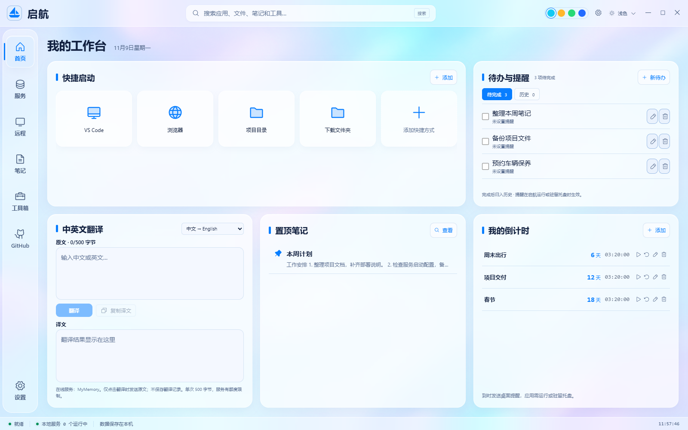
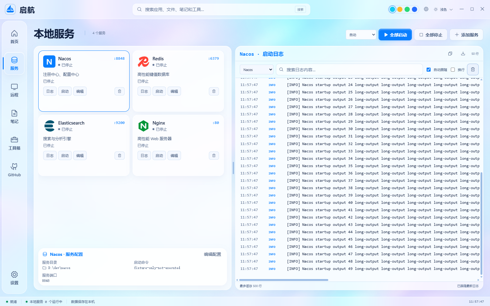
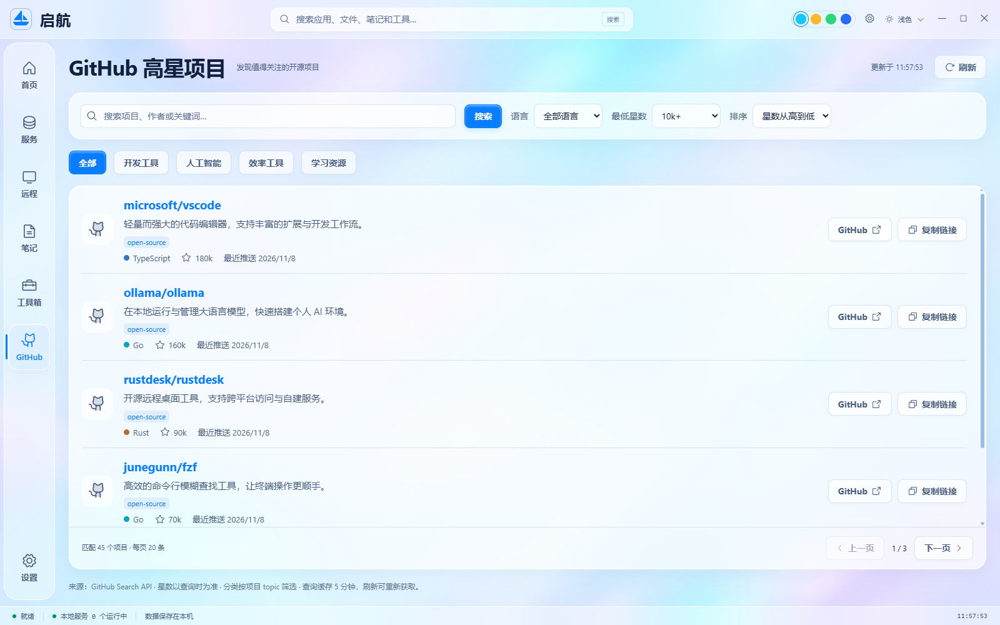

# 启航 · Qihang

一个把本地服务管理、远程监控、独立笔记和日常工具放在一起的 Windows 桌面工作台。

基于 **Electron + React + Vite**，支持毛玻璃、液态玻璃与简洁材质，以及浅色、深色、跟随系统主题。源码使用 [MIT License](LICENSE)。

[功能与使用](docs/USAGE.md) · [开发与贡献](CONTRIBUTING.md) · [构建与发布](docs/RELEASING.md) · [问题反馈](https://github.com/NullDefyer/qihang-desktop/issues) · [安装包](https://github.com/NullDefyer/qihang-desktop/releases)



> 截图使用隔离演示数据。新安装的本地服务和远程服务器列表均为空；GitHub 截图中的星数不是实时排名。

## 能做什么

| 页面 | 功能 |
| --- | --- |
| 首页 | 软件/文件/目录/网址快捷启动、待办提醒与历史、倒计时、中英文翻译、置顶笔记；窗口缩小时自动重排 |
| 服务 | 选择本机目录配置启动命令，单独/批量启停、实时日志、拖动分栏、完整/紧凑/图标自适应布局 |
| 远程 | SSH 连接管理、Linux CPU/内存/磁盘/网络监控、Docker 容器统计与日志、MySQL/MariaDB/Redis 只读监控 |
| 笔记 | 独立纯文本记录、搜索、置顶、自动保存，与服务和日志无关 |
| 工具箱 | 文本处理、JSON/时间戳/编码/UUID、命令收藏与预览执行、C 盘缓存扫描与确认清理 |
| GitHub | 高星公开项目搜索，语言/最低星数/topic 筛选，排序分页、复制链接、跳转仓库 |
| 设置 | 主题材质、透明度/模糊、托盘行为、快捷键、自定义数据/备份目录、导出与恢复 |

常用服务模板：Nacos、Redis、Elasticsearch、RabbitMQ、Kafka、RocketMQ NameServer、ZooKeeper、Nginx，以及自定义服务。模板只提供可编辑配置，不代替中间件安装，也不会自动初始化或启动服务。



## 安装使用

在仓库 [Releases](https://github.com/NullDefyer/qihang-desktop/releases) 获取已发布的 Windows 安装包；如果还没有 Release，可以按下文从源码构建。

安装向导支持选择目录、仅当前用户/所有用户安装。默认业务数据和备份位于安装目录的 `data/`、`backups/`，可在设置中分别更改。升级保留数据；交互卸载提供删除/保留/取消，默认保留。全用户安装通过 Windows SID 子目录隔离数据。

安装包目前未做代码签名。便携版需要保留完整文件夹，不能只复制 `Qihang.exe`。详细存储规则与迁移说明见 [使用说明](docs/USAGE.md)。

## 从源码运行

推荐 **Windows 10/11、Node.js 22 LTS（22.12+）、npm 10+、Git、Windows PowerShell 5.1**。

```powershell
git clone https://github.com/NullDefyer/qihang-desktop.git
cd qihang-desktop
npm ci
npm run desktop
```

只预览前端：

```powershell
npm run dev
```

浏览器模式不会启动本机程序、连接真实 SSH 或清理文件；远程页面使用明确标识的演示数据。GitHub 公开项目查询仍需网络。完整桌面功能以 Windows Electron 版本为准。

## 验证和构建

```powershell
npm test -- --test-concurrency=1
npm run build
npm run test:sites
npm run check:public
npm run build:installer
```

- `npm run build:installer`：生成 `release/Qihang-Setup-<版本>.exe`。
- `npm run build:portable`：生成 `release/qihang-portable/`。
- `npm run check:public`：检查 Git 索引中的公开文件，拒绝运行数据、构建产物和常见凭据格式。
- `npm run export:source`：从最新提交生成干净源码压缩包，不包含未提交修改。

构建需要下载 npm 依赖、Electron 与安装工具链。请按网络情况配置系统/终端代理，不要把认证令牌或本机代理写进仓库。

## 数据和网络

- 服务、笔记、待办、倒计时、命令收藏等保存在本机；运行状态、进程 PID 和采集曲线不跨重启恢复。
- SSH/数据库密码默认不保存；勾选记住后由当前 Windows 用户的 Electron safeStorage 加密。备份不包含这些密码或私钥内容。
- 本地和远程日志默认仅在会话内存缓存；点击导出才写入用户选定的位置。中间件自身可能另外写日志。
- 翻译使用 MyMemory，点击翻译时才发送原文，不保存翻译历史；单次最多 500 UTF-8 字节。
- GitHub 使用公开 Search API，有匿名限流；最多前 1000 条结果，每页 20 条，查询缓存 5 分钟。项目简介保留 API 原文，头像来自 GitHub。
- 本项目不提供退出后的离线服务器监控；提醒需要应用运行或驻留托盘。



## 当前边界

远程主机指标目前面向 Linux；数据库监控支持 MySQL/MariaDB 和 Redis，使用普通数据库 TCP 经 SSH 加密隧道转发，暂不支持独立数据库 TLS。部分会话/事务/锁指标依赖数据库版本和只读账号权限，不可用时显示未知。

C 盘清理仅检查固定缓存目录，先扫描、勾选并确认，再删除至少 7 天未变化的普通文件；不会清理下载/文档或递归删除用户目录。命令收藏和本地服务命令以当前用户权限执行，请只使用可信命令。

文件整理仍标注为后续开放。完整行为见 [使用说明](docs/USAGE.md)，安全问题见 [SECURITY.md](SECURITY.md)。

## 项目结构

```text
src/          React 界面、主题、模型与前端适配
electron/     主进程、受限 IPC、进程/SSH/数据库/存储与清理
scripts/      构建、运行时依赖打包、公开源码检查与导出
build/        NSIS 安装逻辑与卸载数据处理（不含生成清单）
tests/        业务测试与隔离的本机协议夹具
worker/       可选静态浏览器预览入口
.openai/      无账号绑定的静态预览构建输入
docs/         使用、发布说明与脱敏示例截图
```

## 贡献与许可

欢迎通过 [Issue](https://github.com/NullDefyer/qihang-desktop/issues) 提交问题或建议，通过 Pull Request 提交改进。请先阅读 [CONTRIBUTING.md](CONTRIBUTING.md)，不要上传个人配置、真实连接信息或密码。

自有代码采用 [MIT](LICENSE)。第三方依赖和品牌素材见 [THIRD_PARTY_NOTICES.md](THIRD_PARTY_NOTICES.md)。
